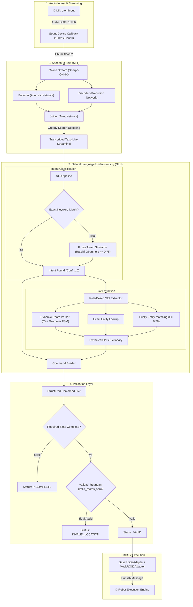
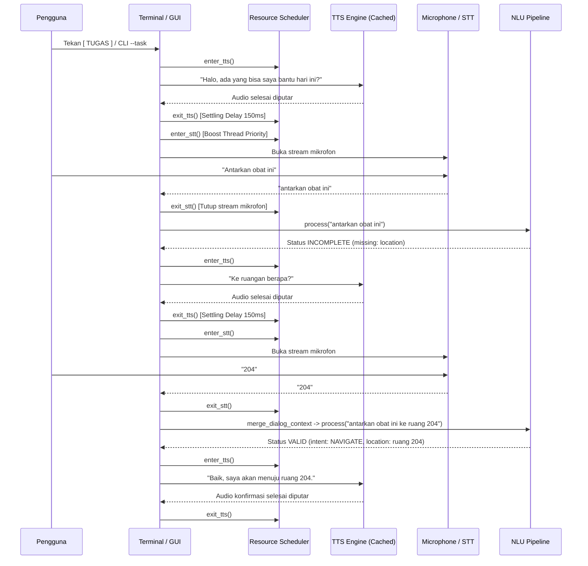

# 🤖 Robot Voice Command NLU Pipeline

Sistem pemrosesan perintah suara (*Voice-to-Command*) bahasa Indonesia untuk robot pelayanan rumah sakit. Pipeline ini mengintegrasikan **Speech-to-Text (STT) real-time streaming berbasis Neural Transducer (RNN-T)**, **Intent Classification**, **Dynamic Slot Extraction**, **Layer Validasi Ruangan**, hingga **Adapter ROS 2**.

---

## 📑 Daftar Isi
- [1. Arsitektur Pipeline & Visualisasi](#1-arsitektur-pipeline--visualisasi)
- [2. Algoritma & Formula Matematis](#2-algoritma--formula-matematis)
  - [2.1 Speech-to-Text: Neural Transducer (Zipformer RNN-T)](#21-speech-to-text-neural-transducer-zipformer-rnn-t)
  - [2.2 Fuzzy Similarity: Ratcliff-Obershelp Pattern Matching](#22-fuzzy-similarity-ratcliff-obershelp-pattern-matching)
  - [2.3 Dynamic Room Parser: Grammar State Machine (FSM)](#23-dynamic-room-parser-grammar-state-machine-fsm)
  - [2.4 Hash-Set Membership Room Validation](#24-hash-set-membership-room-validation)
  - [2.5 Middleware Interfacing: ROS 2 Publish-Subscribe Architecture](#25-middleware-interfacing-ros-2-publish-subscribe-architecture)
- [3. Format Structured Command & Skema Data](#3-format-structured-command--skema-data)
- [4. Intent & Slot Mapping](#4-intent--slot-mapping)
- [5. Mode Interaktif Non-Streaming & Multi-Turn Dialog (TTS ↔ STT)](#5-mode-interaktif-non-streaming--multi-turn-dialog-tts--stt)
  - [5.1 Arsitektur Sequential & Eliminasi Race Condition Audio](#51-arsitektur-sequential--eliminasi-race-condition-audio)
  - [5.2 Resource Scheduling & Task Pinning](#52-resource-scheduling--task-pinning)
  - [5.3 In-Memory Audio Caching & Background Pre-Warming](#53-in-memory-audio-caching--background-pre-warming)
  - [5.4 Penggabungan Konteks Dialog Multi-Turn](#54-penggabungan-konteks-dialog-multi-turn)
  - [5.5 Akselerasi Hardware & Telemetri Real-Time (GPU vs CPU Profile)](#55-akselerasi-hardware--telemetri-real-time-gpu-vs-cpu-profile)
- [6. Desain GUI & Mode Operasi](#6-desain-gui--mode-operasi)
  - [6.1 Mode Pengguna (End-User Kiosk Layanan Mandiri)](#61-mode-pengguna-end-user-kiosk-layanan-mandiri)
  - [6.2 Mode Teknisi (Control Center / Dashboard)](#62-mode-teknisi-control-center--dashboard)
- [7. Struktur Direktori Proyek](#7-struktur-direktori-proyek)
- [8. Panduan Instalasi & Menjalankan](#8-panduan-instalasi--menjalankan)
  - [8.1 Persyaratan Sistem & Akselerasi Hardware](#81-persyaratan-sistem--akselerasi-hardware)
  - [8.2 Setup Dependensi & Model](#82-setup-dependensi--model)
  - [8.3 Cara Menjalankan Program (GUI & CLI)](#83-cara-menjalankan-program-gui--cli)
- [9. Pengujian & Verifikasi](#9-pengujian--verifikasi)

---

## 1. Arsitektur Pipeline & Visualisasi

Berikut adalah diagram alur pemrosesan data end-to-end dari gelombang suara mikrofon hingga pengiriman pesan ke robot melalui ROS 2:



---

## 2. Algoritma & Formula Matematis

### 2.1 Speech-to-Text: Neural Transducer (Zipformer RNN-T)

Sistem STT menggunakan arsitektur **Neural Transducer (RNN-T / Zipformer-Transducer)** yang dioptimasi via ONNX Runtime CPU. 

#### Mengapa Tidak Menggunakan Model Attention/Whisper?
Model speech-to-text generasi sebelumnya berbasis Attention Encoder-Decoder (seperti OpenAI Whisper) beroperasi secara *batch-offline*, di mana seluruh kalimat harus selesai diucapkan terlebih dahulu sebelum proses decoding dimulai. Hal ini menyebabkan jeda respon (*perceived latency*) sebesar 1–3 detik—sangat menghambat interaksi natural pada robot layanan. 

Sebaliknya, **RNN-T beroperasi secara *streaming-native***: audio diproses secara simultan saat suara masih mengalir ke mikrofon (*in-flight partial decoding*).

```
Audio Input (16 kHz) ──► 80-dim Filterbank ──► Acoustic Encoder (Zipformer) ──┐
                                                                              ├──► Joiner ──► Greedy Search ──► Live Text
Previous Non-Blank Tokens ───────────────────► Prediction Decoder (RNN/Stateless)┘
```

#### Formulasi Matematis:

**1. Acoustic / Transcription Network (Encoder)**  
Menerima vektor fitur filterbank 80-dimensi $X = (x_1, x_2, \dots, x_T)$ dan menghasilkan representasi akustik laten:

$$
h_t = \text{Encoder}(x_t), \quad t \in [1, T]
$$

**2. Prediction Network (Decoder)**  
Menerima urutan token teks non-blank yang telah diprediksi sebelumnya $Y_{<u} = (y_1, y_2, \dots, y_{u-1})$:

$$
p_u = \text{Decoder}(y_{u-1}), \quad u \in [1, U]
$$

**3. Joint Network (Joiner)**  
Menggabungkan representasi akustik $h_t$ dan representasi linguistik $p_u$ melalui proyeksi linier dan fungsi aktivasi non-linier $\tanh$:

$$
z_{t, u} = \text{Joiner}(h_t, p_u) = W_z \tanh(W_h h_t + W_p p_u + b_z)
$$

**4. Distribusi Probabilitas Output**  
Distribusi probabilitas atas alfabet token $\mathcal{Y} \cup \lbrace \varnothing \rbrace$ ($\varnothing$ merepresentasikan simbol transisi *blank*):

$$
P(y_{t,u} \mid X, Y_{\lt u}) = \text{Softmax}(z_{t, u}) = \frac{\exp(z_{t, u, k})}{\sum_{j \in \mathcal{Y} \cup \lbrace \varnothing \rbrace} \exp(z_{t, u, j})}
$$

**5. Streaming Chunk & Latency Optimization**  
Audio dialirkan dalam potongan buffer berukuran 100 ms ($N = 1600$ sampel pada frekuensi sampling 16 kHz). Menggunakan decoding *Greedy Search* ($\hat{y} = \arg\max P(y_{t,u})$) yang berkonsumsi CPU minimal tanpa overhead percabangan *beam search*, sehingga *perceived latency* saat pengguna selesai berucap praktis mendekati instan:

$$
\text{Perceived Latency} = t_{\text{speech-end}} - t_{\text{decode-complete}} \approx \mathbf{0.00\text{ ms}}
$$

> [!NOTE]
> **Pustaka & Referensi Ilmiah**:
> 1. **Graves, A.** (2012). *Sequence Transduction with Recurrent Neural Networks*. arXiv preprint [arXiv:1211.3711](https://arxiv.org/abs/1211.3711). (Paper fondasi penemu arsitektur RNN Transducer).
> 2. **Povey, D., Kang, G., Yao, Z., et al.** (2023). *Zipformer: A arbitrary-scale Transformer-like architecture with faster and better convergence for speech recognition*. ICASSP / arXiv preprint [arXiv:2310.19909](https://arxiv.org/abs/2310.19909). (Arsitektur Zipformer k2-fsa).
> 3. **Kuang, F., et al.** (2023). *Sherpa-ONNX: Next-generation Kaldi with ONNX Runtime*. GitHub repository: [k2-fsa/sherpa-onnx](https://github.com/k2-fsa/sherpa-onnx).

---

### 2.2 Fuzzy Similarity: Ratcliff-Obershelp Pattern Matching

Untuk menangani variasi dialek ucapan, singkatan, serta *acoustic slip* dari modul STT (contoh: kata `"bawa"` terdengar sebagai `"bahwa"`, `"anterin"` sebagai `"antar"`, atau `"icuu"` sebagai `"ICU"`), sistem menerapkan algoritma **Ratcliff-Obershelp (Gestalt Pattern Matching)**.

#### Mengapa Ratcliff-Obershelp Lebih Baik dari Levenshtein Distance?
Algoritma *Levenshtein Distance* hanya menghitung jumlah operasi edit tunggal karakter (*insert*, *delete*, *substitute*) tanpa memperhitungkan kelompok substring kontigu. Sebaliknya, Ratcliff-Obershelp menggunakan pendekatan *divide-and-conquer* berbasis kesamaan visual/urutan (*Gestalt approach*):
1. Menemukan substring bersama terpanjang (*Longest Common Substring*) di antara kedua string sebagai penjangkar (*anchor*).
2. Membagi sisa string di sebelah kiri dan kanan anchor secara rekursif untuk menemukan substring cocok berikutnya.
3. Pendekatan ini terbukti jauh lebih toleran terhadap kesalahan transkripsi fonetik bahasa Indonesia yang sering mengalami pergeseran vokal atau penghilangan glottal stop.

#### Formulasi Matematis:

Diberikan string input $S_1$ dan string target $S_2$:

$$
\text{Similarity}(S_1, S_2) = \frac{2 \cdot |\mathcal{K}_{\text{match}}|}{|S_1| + |S_2|}
$$

Di mana $|\mathcal{K}_{\text{match}}|$ adalah total jumlah karakter pada seluruh potongan substring kontigu terpanjang yang sama (*common contiguous substrings*), dihitung secara rekursif:

$$
|\mathcal{K}_{\text{match}}| = |S_{\text{LCS}}| + |\mathcal{K}_{\text{left}}| + |\mathcal{K}_{\text{right}}|
$$

Dengan $|S_1|$ dan $|S_2|$ merepresentasikan panjang karakter masing-masing string ($0.0 \le \text{Similarity} \le 1.0$).

#### Matriks Ambang Batas (Threshold) & Isolasi False Positive:

**Intent Core Action Words** (Ambang batas $\ge 0.75$):

$$
\text{Similarity}(\text{"bahwa"}, \text{"bawa"}) = \frac{2 \times 4}{5 + 4} = \frac{8}{9} \approx 0.889 \ge 0.75 \implies \text{NAVIGATE}
$$

**Entity Location Words** (Ambang batas $\ge 0.78$):

$$
\text{Similarity}(\text{"mlati"}, \text{"melati"}) = \frac{2 \times 5}{5 + 6} = \frac{10}{11} \approx 0.909 \ge 0.78 \implies \text{"ruang melati"}
$$

**Pencegahan False Positive**:  
Kata awalan generik $\mathcal{W}_{\text{prefix}} = \lbrace \text{ruang}, \text{ruangan}, \text{poli}, \text{kamar}, \text{tempat} \rbrace$ **dilarang** berdiri sendiri sebagai target pencocokan fuzzy. Aturan ini memotong anomali di mana kata `"ruang"` (panjang 5) salah terasosiasi ke `"ruang 1"` (panjang 7) karena kemiripan bernilai $\frac{10}{12} \approx 0.833$.

> [!NOTE]
> **Pustaka & Referensi Ilmiah**:
> 1. **Ratcliff, J. W., & Metzener, D. E.** (1988). *Pattern Matching: The Gestalt Approach*. Dr. Dobb's Journal, Issue 139, pp. 46-51. (Paper orisinal Gestalt pattern matching).
> 2. **Python Software Foundation** (2024). *difflib — Helpers for computing deltas (`SequenceMatcher` class)*. Python Standard Library Documentation. [docs.python.org/3/library/difflib.html](https://docs.python.org/3/library/difflib.html).

---

### 2.3 Dynamic Room Parser: Grammar State Machine (FSM)

Modul ini mengimplementasikan **Deterministic Finite Automaton (DFA)** berbasis *lexical shift-reduce* untuk mengenali penomoran ruangan dinamis tanpa batas (*infinite vocabulary*).

#### Alasan Arsitektural:
Di rumah sakit nyata, penomoran ruangan mustahil didaftarkan satu per satu secara statis. Pasien atau tenaga medis dapat menyebutkan nomor kamar secara kasual dalam dua gaya yang sangat berbeda:
- **Gaya Digit Lepas**: *"ruang satu nol empat"* $\rightarrow 104$.
- **Gaya Komparatif/Majemuk**: *"ruang tiga ratus satu"* $\rightarrow 301$.

FSM melakukan *single-pass parsing* berkecepatan tinggi ($\mathcal{O}(N)$ linier terhadap jumlah kata) untuk mengonversi kedua gaya tutur tersebut menjadi nilai integer kanonikal tunggal.

```
[Input Kalimat]
     │
     ├── Regex Prefix Test: r'\b(ruang(?:an)?)\s+(.+)'
     │         │
     │         ├── Kasus 1: Angka Numerik Langsung (\d+) ──► "ruang " + \d+
     │         │
     │         └── Kasus 2: Rangkaian Kata Bilangan Bahasa Indonesia
     │                   │
     │                   ├── Semua Kata Bertipe Digit? (len >= 2)
     │                   │     ├── Ya  ──► Digit Sequence Mode: sum(d * 10^(k-1-i))
     │                   │     └── Tidak
     │                   │           └── Compound Grammar FSM: (Ratusan, Puluhan, Belasan)
```

#### 1. Mode Digit Sequence (Penyebutan Angka Terpisah):
Digunakan saat seluruh kata terdeteksi sebagai angka satuan tunggal ($d_i \in \lbrace 0, \dots, 9 \rbrace$):

$$
N = \sum_{i=0}^{k-1} d_i \cdot 10^{k-1-i}
$$

Contoh:

$$
[\text{"satu"}, \text{"nol"}, \text{"empat"}] \rightarrow [1, 0, 4] \implies 1 \cdot 10^2 + 0 \cdot 10^1 + 4 \cdot 10^0 = 104 \implies \text{"ruang 104"}
$$

#### 2. Mode Compound Grammar (Bilangan Berstruktur Majemuk):
FSM mengevaluasi transisi kata tingkatan (*multipliers*):
- Jika kata modifier berikutnya `"ratus"`: $N = N + (d \times 100)$
- Jika kata modifier berikutnya `"puluh"`: $N = N + (d \times 10)$
- Jika kata modifier berikutnya `"belas"`: $N = N + (d + 10)$
- Prefix leksikal khusus: `seratus` $\rightarrow 100$, `sepuluh` $\rightarrow 10$, `sebelas` $\rightarrow 11$.

> [!NOTE]
> **Pustaka & Referensi Ilmiah**:
> 1. **Hopcroft, J. E., Motwani, R., & Ullman, J. D.** (2006). *Introduction to Automata Theory, Languages, and Computation* (3rd ed.). Addison-Wesley. (Formalisasi Finite State Automata, State Transitions, & Regular Grammars).
> 2. **Knuth, D. E.** (1965). *On the translation of languages from left to right*. Information and Control, 8(6), 607-639. (Prinsip determinisme LR parsing).

---

### 2.4 Hash-Set Membership Room Validation

Untuk menjamin keselamatan fisik (*safety-critical constraint*) pergerakan robot di rumah sakit, nama lokasi yang berhasil diekstrak harus terverifikasi secara resmi dalam database rumah sakit ([`valid_rooms.json`](file:///c:/Users/hande/command-inst/nlu/valid_rooms.json)).

#### Mengapa Layer Ini Sangat Penting?
Robot pelayanan rumah sakit tidak boleh mengeksekusi navigasi ke ruangan fiktif, halusinasi NLU, atau area terlarang (misal: `"ruang 999"` atau `"ruang antah berantah"`). Layer ini memvalidasi keabsahan tujuan sebelum instruksi dikirim ke kontroler motor robot.

#### Formulasi Matematis:

$$
\text{Status}(loc) = \begin{cases} 
\text{VALID}, & \text{jika } \text{lower}(loc) \in \mathcal{S}_{\text{valid}} \\
\text{INVALID-LOCATION}, & \text{jika } \text{lower}(loc) \notin \mathcal{S}_{\text{valid}}
\end{cases}
$$

Di mana $\mathcal{S}_{\text{valid}}$ diindeks sebagai struktur data **Hash Set** (`set` Python):
- **Kompleksitas Komputasi**: $\mathcal{O}(1)$ average lookup time melalui fungsi dispersi *hash table* (Open Addressing dengan Algoritma Perturbasi CPython).
- **Integritas Dinamis**: Ketika pihak rumah sakit menambahkan poli atau kamar baru ke `valid_rooms.json`, sistem otomatis memuatnya tanpa perlu *re-compile* atau *re-train* model NLU.

> [!NOTE]
> **Pustaka & Referensi Ilmiah**:
> 1. **Cormen, T. H., Leiserson, C. E., Rivest, R. L., & Stein, C.** (2009). *Introduction to Algorithms* (3rd ed.). MIT Press. (Chapter 11: Hash Tables, Direct-address Tables, and Universal Hashing).
> 2. **Hettinger, R.** (2003). *Python's Dictionary Implementation: Being All Things to All People*. Python Software Foundation.

---

### 2.5 Middleware Interfacing: ROS 2 Publish-Subscribe Architecture

Sistem dirancang *decoupled* dari hardware spesifik menggunakan standar komunikasi robotika industri **ROS 2 (Robot Operating System 2)**:

- Menggunakan protokol **Data Distribution Service (DDS)** untuk komunikasi antar-proses secara *real-time* dan *fault-tolerant*.
- Payload perintah terstruktur dipublikasikan ke topik ROS 2 (`/robot_command` / `/navigation_goal`) dan dapat langsung dikonsumsi oleh Navigation Stack (**Nav2**) atau sistem Behavior Tree robot otonom.

> [!NOTE]
> **Pustaka & Referensi Ilmiah**:
> 1. **Macenski, S., Foote, T., Gerkey, B., Lalancette, C., & Woodall, W.** (2022). *Robot Operating System 2: Design, architecture, and uses in the technology ecosystem*. Science Robotics, 7(66), eabm6074. DOI: [10.1126/scirobotics.abm6074](https://doi.org/10.1126/scirobotics.abm6074).
> 2. **Object Management Group (OMG)**. *Data Distribution Service (DDS) Specification*. OMG Standard. [omg.org/spec/DDS/](https://www.omg.org/spec/DDS/).

---

## 3. Format Structured Command & Skema Data

Format dictionary command standar yang dihasilkan oleh pipeline:

```json
{
  "intent": "NAVIGATE",
  "slots": {
    "location": "ruang melati"
  },
  "confidence": 1.0,
  "status": "VALID",
  "missing_slots": [],
  "ros2_sent": true
}
```

### Penjelasan Field:
| Field | Tipe | Deskripsi |
|---|---|---|
| `intent` | `string` | Kategori niat perintah (`NAVIGATE`, `MOVE`, dll.) |
| `slots` | `dict` | Parameter entitas perintah yang terekstrak |
| `confidence` | `float` | Tingkat kepastian klasifikasi (`0.0` s.d. `1.0`) |
| `status` | `string` | Status validasi: `VALID`, `INCOMPLETE`, `INVALID_LOCATION`, `UNKNOWN_INTENT` |
| `missing_slots`| `list` | Daftar slot wajib yang belum terpenuhi jika berstatus `INCOMPLETE` |
| `ros2_sent` | `bool` | `true` jika perintah sukses diteruskan ke ROS 2 adapter, `false` jika ditahan |

---

## 4. Intent & Slot Mapping

### Daftar Intent yang Didukung
| Intent | Deskripsi | Slot Wajib | Slot Opsional |
|---|---|---|---|
| `NAVIGATE` | Mengarahkan robot ke titik tujuan | `location` | - |
| `MOVE` | Gerakan dasar robot (maju, mundur, belok) | `direction` | `distance`, `unit` |
| `STOP` | Menghentikan semua pergerakan robot | - | - |
| `GO_BACK` | Mengembalikan robot ke titik awal / putar balik | - | `location` |
| `WAIT` | Memerintahkan robot untuk diam menunggu | - | `duration` |
| `FOLLOW` | Memerintahkan robot mengikuti target | - | `person` |
| `UNKNOWN` | Perintah di luar domain atau tidak dikenali | - | - |

---

## 5. Mode Interaktif Non-Streaming & Multi-Turn Dialog (TTS ↔ STT)

Selain mode streaming konvensional (`[ TALK ]`), sistem menyediakan **Mode Tugas Dialog Interaktif Non-Streaming**. Mode ini dirancang khusus untuk meminimalisir *race condition* pada perangkat audio (ALSA) dan menghemat utilisasi CPU pada single-board computer seperti **Raspberry Pi 4 Model B**.

### 5.1 Arsitektur Sequential & Eliminasi Race Condition Audio

Pada robot layanan, speaker (TTS) dan mikrofon (STT) sering kali saling berebut resource audio jika berjalan bersamaan (*ALSA duplex contention / xrun*), atau suara robot yang keluar dari speaker terdengar kembali oleh mikrofon (*self-echo acoustic loop*).

Arsitektur penjadwalan sekuensial mengisolasi penuh fase audio:
1. **TTS Greeting**: Robot menyapa *"Halo, ada yang bisa saya bantu hari ini?"*.
2. **Acoustic Settling (150ms)**: Jeda waktu hening singkat setelah TTS selesai untuk membiarkan pantulan/gema suara di ruangan menghilang sempurna.
3. **STT Single-Shot Recording**: Mikrofon aktif mendengarkan perintah awal pengguna (misal: *"antarkan obat ini"*).
4. **NLU Verification & Clarification**: Jika status perintah `INCOMPLETE` (misal slot `location` kosong):
   - Robot berbicara via TTS menanyakan slot yang hilang: *"Ke ruangan berapa?"*
   - Mikrofon mendengarkan jawaban spesifik pengguna (misal: *"204"* atau *"ke ruang 204"*).
   - Dialog context merger secara otomatis menggabungkan konteks: *"antarkan obat ini ke ruang 204"*.
5. **TTS Konfirmasi Akhir**: Robot mengonfirmasi aksi (*"Baik, saya akan menuju ruang 204."*) dan meneruskan payload ke ROS 2 adapter.



### 5.2 Resource Scheduling & Task Pinning (`scheduler.py`)

- **OS Thread Priority Boosting**: Thread capture audio (`sd.InputStream`) dan worker decode STT/TTS dinaikkan prioritasnya menjadi **Above Normal** (`SetThreadPriority` di Windows / `os.nice` di Linux). Ini menjamin tidak terjadi audio dropout saat background OS process sedang aktif.
- **Task Pinning (CPU Core Affinity)**: Tersedia fungsi `pin_current_thread_to_cores()` menggunakan native Linux `os.sched_setaffinity` (ideal untuk 4-Core Cortex-A72 pada Raspberry Pi 4) atau `SetThreadAffinityMask` pada Windows.
- **Audio Mutual Exclusion**: Menjamin hanya satu audio I/O stream (Speaker ATAU Mikrofon) yang mengakses driver audio pada satu waktu.

### 5.3 Multi-Level Audio Caching & Background Pre-Warming (`tts.py`, `.tts_cache/`)

- **L1 In-Memory Audio Cache**: Kalimat berulang disimpan di memori RAM sebagai array `float32`. Sintesis ONNX untuk kalimat umum berkurang menjadi **0.001 ms (0% CPU cost)**.
- **L2 Persistent Disk Cache**: Audio terkompresi disimpan ke folder `.tts_cache/` sehingga cache tetap tersedia antar-restart tanpa sintesis ulang.
- **Background Pre-Warming (`warmup_async()`)**: Engine Sherpa-ONNX Piper VITS diinisialisasi pada background thread saat aplikasi start agar responsivitas langsung instan tanpa *cold-start delay*.
- **Mic Cue Chime & Acoustic Settling Delay**: Nada santun dua-nada (*dual-tone harmonic chime*) dimainkan sesaat sebelum mikrofon aktif dengan *hanning smoothing window* dan jeda akustik 200 ms agar gema speaker hilang tuntas sebelum STT mulai mendengarkan.

### 5.4 Pre-Optimized ONNX Encoder & Lazy STT Loading (`stt.py`)

- **Lazy Loading (`_LazyRecognizer`)**: Mengimpor modul STT tidak lagi memblokir eksekusi startup program (instan 0 detik).
- **Background Preloading (`preload_async()`)**: Model STT dimuat di background thread saat menu atau sapaan awal berjalan.
- **INT8 Quantization Awareness**: Model INT8 (`.int8.onnx`) yang telah terkuantisasi digunakan langsung secara optimal tanpa memaksakan sesi optimasi ONNX Runtime CPU eksternal yang tidak kompatibel.

### 5.5 Penggabungan Konteks Dialog Multi-Turn (`nlu/dialog.py`)

Fungsi penggabung konteks menangani variasi jawaban klarifikasi pengguna:
- **Digit Normalization**: Jawaban murni angka seperti `"204"` otomatis dipetakan menjadi `"ruang 204"`.
- **Preposition Guard**: Jawaban yang sudah diawali preposisi (`"ke ruang 204"`) dicegah dari duplikasi kata depan (*"antarkan obat ini ke ke ruang 204"* dicegah).
- **Slot Routing**: Jawaban arah (`"kanan"` $\rightarrow$ `"ke kanan"`) dan orang (`"dokter budi"` $\rightarrow$ `"ikuti dokter budi"`) digabungkan sesuai semantik masing-masing intent.

### 5.6 Variasi Respons Alami Robot (`responses.py`)

Menghindari kalimat robot yang kaku dan monoton dengan variasi template sapaan awal (`greeting()`), konfirmasi navigasi (`navigate_confirm()`), pertanyaan lokasi (`ask_location()`), dan *fallback* perintah tak dikenali (`unknown_intent()`).

### 5.7 Akselerasi Hardware & Telemetri Real-Time (`hw_monitor.py`)

Untuk memastikan model neural network berjalan secara optimal pada perangkat komputasi tepi (*edge AI*), sistem dilengkapi modul telemetri khusus:
- **Deteksi GPU NVIDIA Jetson & CUDA Execution Provider**: Mendeteksi secara dinamis apakah model STT (Zipformer RNN-T) dan TTS (Piper VITS) dieksekusi menggunakan akselerator **GPU CUDA** atau fallback ke **CPU Multi-Core**.
- **Non-Blocking GPU (GR3D) Monitoring**: Membaca utilisasi engine 3D/Compute GPU Jetson langsung dari sysfs Linux (`/sys/devices/platform/gpu.0/load`) dengan overhead nol tanpa blocking sleep.
- **Telemetri Sistem Komprehensif**: Mengukur utilisasi multi-core CPU (via delta kalkulasi non-blocking `/proc/stat`), konsumsi memori RAM (`/proc/meminfo`), dan sensor suhu termal CPU/GPU (`/sys/class/thermal`).
- **Antarmuka Terintegrasi**: Data telemetri dipancarkan secara berkala ke badge header GUI, panel teknisi, dan live dashboard terminal CLI (`python main.py --monitor`).

---

## 6. Desain GUI & Mode Operasi

Antarmuka GUI dibangun menggunakan **Tkinter** dengan arsitektur **Modern Dual-View Kiosk (Matte Charcoal Theme)** yang dirancang ramah pengguna dan sangat responsif.

### 6.1 Mode Pengguna (End-User Kiosk Layanan Mandiri)
Dirancang khusus untuk pasien dan pengunjung rumah sakit:
- **Header Global & Compute Badge**: Menampilkan status robot, mikrofon aktif, dan badge akselerasi real-time (`⚡ GPU: CUDA (xx%)` atau `💻 CPU (xx%)`).
- **Persona Hero Card**: Menampilkan ekspresi wajah avatar ASCII dinamis (`(◕‿◕)`, `(👂‿👂)`, `(★‿★)`, `(＾▽＾)`, `(×_×)`) sesuai status interaksi robot.
- **Giant Touch Voice Button**: Tombol sentuh sentral 1-ketukan untuk berbicara (*"SENTUH UNTUK BERBICARA"*). Dilengkapi indikator teks real-time yang langsung memperbarui tampilan tombol begitu ucapan pengguna mulai terdeteksi oleh mikrofon.
- **Pilihan Tujuan Cepat (Instant Tiles)**: Ubin 1-sentuh ke tujuan favorit (Ruang ICU, Ruang IGD, Farmasi/Apotek, Poli Jantung, Poli Anak, Lobi Utama, Berhenti, Kembali ke Pos).
- **Switch Opsi Tugas**:
  - **🧭 Penunjuk Arah**: Robot memandu dan mengantar pengguna langsung ke lokasi tujuan.
  - **💊 Antar Obat**: Robot membawa dan mengantarkan suplai obat medis ke ruangan tujuan.
- **Konfirmasi Suara 2-Arah Natural**: Pada pengantaran penting, robot mengonfirmasi dengan suara (*"Saya akan mengantarkan obat ke ruang ICU. Apakah sudah benar?"*). Panduan `(Ucapkan 'benar' untuk lanjut, 'tidak' untuk batal)` ditampilkan secara visual di layar tanpa dibacakan TTS agar tidak bising dan ringkas.
- **Balon Percakapan Real-Time**: Feed chat bersih yang mencatat percakapan antara pengguna dan robot secara kronologis.
- **Input Pencarian Sentuh**: Kolom ketik sentuh dengan tombol *Kirim* untuk pengguna yang lebih memilih interaksi teks.

### 6.2 Mode Teknisi (Control Center / Dashboard)
Dirancang untuk teknisi, administrator, dan integrasi robotik:
- **Monitor Akselerasi Komputasi (GPU vs CPU)**: Panel visual interaktif yang menampilkan identitas chip hardware (misal *NVIDIA Jetson Orin Nano*), status execution provider STT & TTS, utilisasi memori RAM, sensor suhu, serta *progress bar* real-time utilisasi engine **GPU (GR3D)** dan **CPU**.
- **Telemetri NLU Real-Time**: Menampilkan live transkripsi STT, Intent terdeteksi beserta confidence score, parameter slots, dan status validasi.
- **Monitor Transmisi Payload Node ROS 2**: Indikator visual real-time status pengiriman JSON payload ke Socket TCP ROS 2 (`● TERKIRIM ✓`, `✕ GAGAL KIRIM`, `⏸ DITAHAN`).
- **Modal Konfigurasi Endpoint ROS 2**: Pengaturan Custom IP & Port target robot dengan tombol preset cepat (*Robot 10.107.245.221* dan *Localhost 127.0.0.1*) serta fitur **Uji Ping TCP** interaktif sebelum disimpan ke `ros2_config.json`.
- **Diagnostik Mikrofon**: Modal pemilih hardware mikrofon audio dan penguji level volume audio (RMS & Peak amplitude).
- **Console Log Percakapan**: Riwayat debug lengkap seluruh event sistem audio, NLU, dan komunikasi socket.

---

## 7. Struktur Direktori Proyek

Proyek ini telah direfaktor secara penuh ke dalam arsitektur modular per-domain yang bersih:

```text
command-inst/
├── main.py                     # Entry point utama aplikasi (< 170 baris)
├── config.py                   # Konfigurasi global (model path, sample rate, threads, mic)
├── hw_monitor.py               # Monitor telemetri real-time GPU (Tegra/CUDA), CPU, RAM & suhu
├── responses.py                # Variasi template respons dialog robot
├── download_model.py           # Script pengunduh & verifikasi model offline STT & TTS
├── quantize_model.py           # Script optimasi kuantisasi model ONNX INT8
│
├── audio/                      # Audio & Speech Processing Layer
│   ├── __init__.py             # Ekspor utilitas audio
│   ├── stt.py                  # Engine STT Sherpa-ONNX streaming Zipformer RNN-T
│   ├── tts.py                  # Engine TTS offline Piper VITS, 2-level disk cache, chime cue
│   ├── scheduler.py            # Hardware scheduling, thread priority, & mutual exclusion
│   └── utils.py                # Deteksi hardware mic, query rate/channel, resampling DSP
│
├── nlu/                        # Natural Language Understanding Layer
│   ├── __init__.py             # Inisialisasi package NLU
│   ├── intent_classifier.py    # Klasifikasi intent (Keyword Fast-Path + Ratcliff-Obershelp)
│   ├── slot_extractor.py       # Ekstraksi slot (C++ Grammar FSM + Fuzzy Entity Matcher)
│   ├── room_validator.py       # Layer validasi ruangan (O(1) Hash Set Lookup)
│   ├── command_builder.py      # Pembentuk structured JSON payload
│   ├── pipeline.py             # Orkestrasi alur kerja NLU modular end-to-end
│   ├── dialog.py               # Penggabungan konteks multi-turn & format pesan konfirmasi
│   ├── ros2_adapter.py         # Socket TCP adapter transmisi payload ke Node ROS 2
│   ├── entities.py             # Kamus entitas ruangan, arah, dan personil rumah sakit
│   └── valid_rooms.json        # Basis data 74 nama ruangan terdaftar
│
├── gui/                        # Graphical User Interface (Dual-View Tkinter)
│   ├── __init__.py             # Ekspor run_gui_mode dan RobotGUIApp
│   ├── app.py                  # Controller utama GUI, event loop, & background threads
│   ├── theme.py                # Design tokens: palet warna, tipografi font, hover effects
│   ├── modals.py               # Dialog modal pemilihan mic & konfigurasi IP/Port ROS 2
│   ├── user_view.py            # View Mode Pengguna (Kiosk layanan mandiri pasien)
│   └── admin_view.py           # View Mode Teknisi (telemetri NLU, hardware monitor & ROS 2)
│
├── cli/                        # Command Line Interface Layer
│   ├── __init__.py             # Ekspor fungsi-fungsi CLI runner
│   └── runner.py               # Runner tugas dialog terminal, streaming CLI, & diagnostik
│
├── tests/                      # Test Suite & Otomasi Verifikasi
│   └── test_nlu.py             # 121 Unit & End-to-End Test Cases
│
├── pyproject.toml              # Konfigurasi dependensi project (uv / pip)
├── requirements.txt            # Requirements pip standar
└── README.md                   # Dokumentasi teknis & panduan lengkap
```

---

## 8. Panduan Instalasi & Menjalankan

### 8.1 Persyaratan Sistem & Akselerasi Hardware
- Python `>= 3.10`
- Perangkat mikrofon yang terhubung (USB / I2S / Array mic)
- Speaker / Jack audio 3.5mm / HDMI (untuk audio respons robot)

#### Dukungan Akselerasi Komputasi:
- **NVIDIA Jetson (Orin Nano / Orin NX / AGX / Xavier) & GPU CUDA**:
  - Menggunakan paket `sherpa-onnx` dengan varian `+cuda` (`provider="cuda"`).
  - Memanfaatkan *Unified Memory Architecture* (UMA) Jetson untuk inferensi streaming STT dan sintesis TTS dengan latensi ultra-rendah tanpa beban CPU tinggi.
- **CPU Multi-Core (Raspberry Pi 4 / PC x86_64 / ARM64 Standar)**:
  - Menggunakan ONNX Runtime CPU dengan model terkuantisasi INT8 (`encoder.int8.onnx`, `joiner.int8.onnx`) dan alokasi multi-thread yang optimal.

---

### 8.2 Setup Dependensi & Model

#### Instalasi Dependensi via `uv` (Direkomendasikan - Sangat Cepat):
```bash
# Sinkronisasi virtual environment
uv sync

# Atau instal langsung via requirements.txt
uv pip install -r requirements.txt
```

#### Instalasi via `pip` Standar:
```bash
pip install -r requirements.txt
```

> [!TIP]
> Pada sistem berbasis Linux / Debian / JetPack / Raspberry Pi OS, pastikan pustaka audio sistem dan Tkinter telah terpasang:
> ```bash
> sudo apt update && sudo apt install -y portaudio19-dev libasound2-dev libsndfile1 python3-tk
> ```

#### Unduh Model Offline STT & TTS:
```bash
uv run python download_model.py
# atau:
python download_model.py
```
> Skrip otomatis memeriksa file yang sudah ada di folder `model/` dan hanya mengunduh file yang belum lengkap.

---

### 8.3 Cara Menjalankan Program (GUI & CLI)

#### 1. Mode GUI Tkinter Desktop (Default):
```bash
uv run python main.py
# atau paksa mode GUI:
uv run python main.py --gui
```
- Berjalan otomatis dalam **Mode Kiosk Pengguna** dengan indikator `⚡ GPU: CUDA (xx%)` di kanan atas header.
- Tekan **`[ 🛠️ Mode Teknisi ]`** untuk membuka panel telemetri lengkap, diagnostik NLU, pengatur endpoint ROS 2, dan grafik utilisasi **GPU (GR3D)** serta **CPU**.

#### 2. Mode Live Monitor Hardware & Telemetri Komputasi (Terminal):
Jika Anda ingin memantau secara langsung apakah model sedang berjalan di GPU atau CPU di terminal terpisah (mirip `jtop`/`tegrastats` versi ringkas):
```bash
uv run python main.py --monitor
```
Menampilkan:
- Identitas board & arsitektur (misal: *NVIDIA Jetson Orin Nano*).
- Status execution provider STT & TTS (`CUDA` atau `CPU`).
- Bar visual persentase utilisasi **GPU Core (GR3D)** dan suhu termal real-time.
- Bar visual persentase **CPU Multi-Core**, suhu, dan penggunaan memori RAM.

#### 3. Mode Menu CLI Interaktif (Terminal Headless / Ubuntu Server):
Cocok saat menjalankan program melalui sesi SSH atau server tanpa tampilan monitor:
```bash
uv run python main.py --cli
```
Pilihan menu:
- `[1]` Mode Tugas Dialog Interaktif (TTS ↔ STT Sequential)
- `[2]` Bicara Langsung via Mikrofon (Streaming STT + NLU)
- `[3]` Ketik Perintah Teks Manual (Pengujian Cepat)
- `[4]` List Seluruh Perangkat Input Audio
- `[5]` Tes Diagnosa & Level Volume Mikrofon (RMS & Peak)
- `[6]` Monitor Hardware (GPU vs CPU Live Telemetry) (Tegra/CUDA)
- `[q]` Keluar

#### 4. Mode Tugas Dialog Interaktif (Terminal CLI):
Alur percakapan 2-arah terpandu sekuensial (Robot menyapa $\rightarrow$ dengarkan pengguna $\rightarrow$ tanya kekurangan slot $\rightarrow$ konfirmasi suara $\rightarrow$ publish ke ROS 2):
```bash
uv run python main.py --task
# atau alias:
uv run python main.py --tugas
```

#### 5. Kustomisasi Target Node ROS 2 via Argumen:
```bash
python main.py --ros2-host 192.168.1.120 --ros2-port 5000
```

#### 6. Mode Mikrofon Langsung 1-Kali (Streaming Terminal):
```bash
# Rekam suara langsung 5 detik via terminal
python main.py --mic

# Rekam dengan durasi & ID mic spesifik
python main.py --mic --duration 7 --device 1
```

#### 7. Cek & Diagnosa Driver Mikrofon:
```bash
# Tampilkan daftar seluruh mikrofon terdeteksi
python main.py --list-devices

# Rekam sampel uji coba 3 detik dan analisis level sinyal audio
python main.py --test-mic
```

#### 8. Mode Teks Langsung (Tanpa Mikrofon, Uji NLU Cepat):
```bash
python main.py --text "tolong antarkan obat ke ruang ICU"
python main.py --text "antar saya ke ruang 204"
python main.py --text "maju dua meter"
python main.py --text "berhenti sekarang"
```

---

## 9. Pengujian & Verifikasi

Proyek ini dilengkapi test suite komprehensif yang mencakup pengujian intent classification, slot extraction, validasi kelengkapan, validasi ruangan, parsing angka dinamis, hingga penanganan typo fonetik STT.

Jalankan pengujian:
```bash
python tests/test_nlu.py
```

**Hasil Pengujian:**
```text
==================================================
NLU PIPELINE TEST SUITE
==================================================
  TEST: Intent Classification          -> ALL PASS
  TEST: Slot Extraction                -> ALL PASS
  TEST: Command Validation             -> ALL PASS
  TEST: End-to-End Pipeline            -> ALL PASS
  TEST: Dynamic Room Number (Grammar)  -> ALL PASS
  TEST: Fuzzy Matching (STT Typos)     -> ALL PASS
==================================================
SUMMARY: 121 passed, 0 failed
==================================================
```

